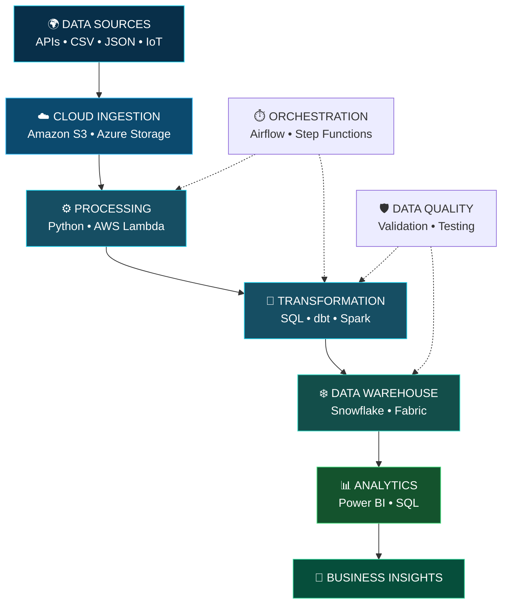
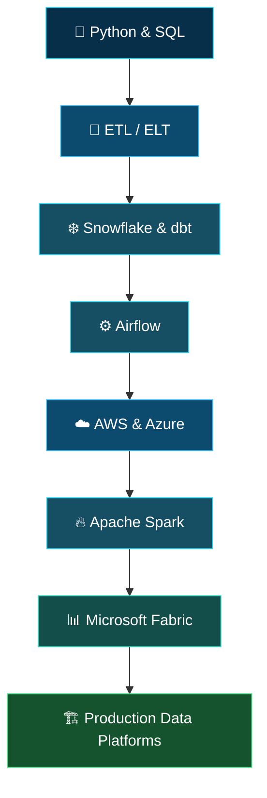

 <div align="center">

<a href="https://github.com/shariq-13">

</a>


<br/>


<br/><br/>

<a href="https://github.com/shariq-13?tab=followers"></a>
<a href="https://github.com/shariq-13?tab=repositories"></a>


<br/><br/>

<a href="YOUR_LINKEDIN_URL"></a>
<a href="mailto:YOUR_EMAIL"></a>
<a href="https://github.com/shariq-13"></a>

</div>

---

<div align="center">

## ⚡ THE DATA ENGINEERING ZONE


**I BUILD • I AUTOMATE • I TRANSFORM • I ENGINEER**

</div>

## 👨‍💻 WHO AM I?

I'm **Shariq Ahmad**, a Cloud Data Engineer passionate about cloud technologies, modern data platforms, and scalable data engineering solutions.

My focus is on designing end-to-end data pipelines that move data from different sources into reliable, analytics-ready platforms.

```python
class CloudDataEngineer:

    def __init__(self):
        self.name = "Shariq Ahmad"
        self.role = "Cloud Data Engineer"
        self.location = "Karachi, Pakistan 🇵🇰"

        self.cloud = ["AWS", "Azure"]
        self.warehouse = ["Snowflake"]
        self.languages = ["Python", "SQL"]
        self.tools = [
            "dbt",
            "Apache Airflow",
            "Apache Spark",
            "Microsoft Fabric",
            "Terraform"
        ]

        self.current_focus = [
            "Cloud Data Engineering",
            "ETL / ELT Pipelines",
            "Data Warehousing",
            "Workflow Orchestration"
        ]

    def engineer(self):
        return "Turning Raw Data into Valuable Insights 🚀"


me = CloudDataEngineer()
print(me.engineer())
```

---

## 🌐 MY CLOUD & DATA TECHNOLOGY UNIVERSE

<div align="center">

### ☁️ Cloud Platforms


### 🐍 Programming & Query Languages


### ❄️ Data Warehousing & Processing


### ⚙️ DevOps & Tools


### 📊 Business Intelligence


</div>

---

## 🔬 DATA PIPELINE LAB

<div align="center">


</div>



---

## 🚀 PROJECT SHOWCASE

<div align="center">

### ENGINEERING IN ACTION

</div>

<table>
<tr>
<td width="50%" valign="top">

### ☁️ AWS SERVERLESS ETL

<a href="https://github.com/shariq-13/Serverless_ETL_pipeline">

</a>

`AWS` `Python` `Lambda` `S3` `SNS`

Serverless processing, workflow orchestration, conditional execution and error notifications.

**[VIEW PROJECT →](https://github.com/shariq-13/Serverless_ETL_pipeline)**

</td>
<td width="50%" valign="top">

### ❄️ SPARKIFY DATA WAREHOUSE

<a href="https://github.com/shariq-13/Sparkify-data-warehousing">

</a>

`Snowflake` `dbt` `SQL`

Data modeling, fact and dimension tables, transformation models and data testing.

**[VIEW PROJECT →](https://github.com/shariq-13/Sparkify-data-warehousing)**

</td>
</tr>
</table>

### 🌫️ SMART CITY AIR QUALITY PIPELINE

`Python` `Snowflake` `SQL` `IoT`

- Sensor data ingestion from multiple cities.
- Time-series data management.
- Snowflake Bronze layer architecture.

### 🍔 ZOMATO AI DATA ENGINEERING

`Python` `Snowflake` `Gemini API`

- Customer review extraction.
- AI-based sentiment classification.
- Enrichment and storage of processed reviews.

### 🏅 TOKYO OLYMPICS AZURE DATA ENGINEERING

`Microsoft Azure` `Azure Storage` `SQL`

- Cloud data ingestion.
- Data transformation.
- Analytical dataset preparation.

---

## 📊 GITHUB COMMAND CENTER

<div align="center">


<br/>


</div>

---


<h2 align="center">📊 GitHub Contribution Activity</h2>

<div align="center">
  
</div>


---

## 🐍 WATCH MY CONTRIBUTIONS COME ALIVE

<div align="center">


</div>

---

## 🏆 GITHUB TROPHIES


<div align="center">
  
</div>

<picture>
  <source media="(prefers-color-scheme: dark)" srcset="https://raw.githubusercontent.com/shariq-13/shariq-13/output/github-contribution-grid-snake-dark.svg">
  <source media="(prefers-color-scheme: light)" srcset="https://raw.githubusercontent.com/shariq-13/shariq-13/output/github-contribution-grid-snake.svg">
  
</picture>

---

## 🎯 ENGINEERING ROADMAP



**Currently focusing on:**

- Microsoft Fabric & DP-700.
- Advanced Snowflake SQL.
- dbt and data transformation.
- Apache Airflow.
- AWS and Azure cloud architecture.
- Apache Spark and distributed processing.
- Terraform and Infrastructure as Code.

---

## 🤝 LET'S BUILD SOMETHING GREAT

<div align="center">


<a href="YOUR_LINKEDIN_URL">

</a>
<a href="mailto:YOUR_EMAIL">

</a>
<a href="https://github.com/shariq-13">

</a>

<br/><br/>

### ☁️ DATA IS THE FOUNDATION. ENGINEERING IS THE POWER.

**Turning Raw Data Into Reliable Insights.**


</div>
