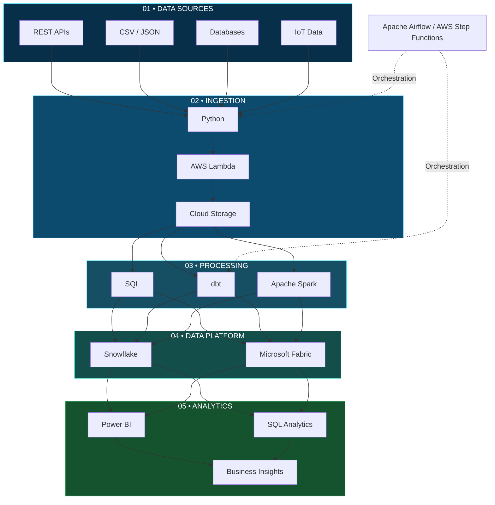

 

 

  

  

---

## ◈ THE ENGINEER BEHIND THE DATA

### 👨‍💻 About Me

I'm **Shariq Ahmad**, a Cloud Data Engineer focused on building end-to-end data engineering solutions and exploring modern cloud data platforms.

I enjoy designing data pipelines, developing ETL/ELT workflows, transforming datasets, and building cloud-based analytical solutions.

- ☁️ Cloud platforms: AWS and Microsoft Azure.
- ❄️ Data warehousing: Snowflake.
- 🔄 Data transformation: Python, SQL and dbt.
- ⚙️ Workflow orchestration: Apache Airflow and AWS Step Functions.
- 🔥 Distributed processing: Apache Spark and PySpark.
- 📊 Analytics: Microsoft Fabric and Power BI.
- 🏗️ Infrastructure: Terraform and Linux.

**My engineering philosophy:** Understand the data, design the architecture, automate the workflow, and build reliable solutions.

---

## ◈ CLOUD DATA ENGINEERING ECOSYSTEM

  

### Technology domains

| Domain | Technologies |
|---|---|
| Cloud | AWS, Microsoft Azure |
| Languages | Python, SQL, Bash |
| Data Warehouse | Snowflake |
| ETL / ELT | Python, SQL, dbt |
| Processing | Apache Spark, PySpark |
| Orchestration | Apache Airflow, Step Functions |
| Storage | Amazon S3, Azure Storage |
| Databases | PostgreSQL, MySQL |
| Analytics | Microsoft Fabric, Power BI |
| DevOps | Git, GitHub, Linux, Terraform |

---

## ◈ DATA ENGINEERING ARCHITECTURE

### From data sources to business intelligence

---

## ◈ FEATURED PROJECT PORTFOLIO

### Building practical cloud data engineering solutions

<table>
<tr>
<td width="50%" valign="top">

<h3>☁️ AWS Serverless ETL</h3>

**Technologies**

`AWS` `S3` `Lambda` `Python` `SNS` `Step Functions`

- Serverless data processing.
- Automated workflow orchestration.
- Conditional execution.
- Error handling and notifications.

<a href="https://github.com/shariq-13/Serverless_ETL_pipeline">Explore Project →</a>

</td>
<td width="50%" valign="top">

<h3>❄️ Sparkify Data Warehouse</h3>

**Technologies**

`Snowflake` `dbt` `SQL` `Data Modeling`

- Staging and transformation models.
- Fact and dimension tables.
- dbt testing and documentation.
- Analytical data warehouse.

<a href="https://github.com/shariq-13/Sparkify-data-warehousing">Explore Project →</a>

</td>
</tr>
<tr>
<td width="50%" valign="top">

<h3>🌫️ Smart City AQI Pipeline</h3>

**Technologies**

`Python` `Snowflake` `SQL` `IoT`

- IoT sensor data ingestion.
- Multi-city air quality readings.
- Snowflake Bronze data layer.
- Time-series data management.

</td>
<td width="50%" valign="top">

<h3>🍔 Zomato AI Data Pipeline</h3>

**Technologies**

`Python` `Snowflake` `Gemini API`

- Customer review extraction.
- AI sentiment classification.
- Data enrichment.
- Snowflake result storage.

</td>
</tr>
<tr>
<td width="50%" valign="top">

<h3>🏅 Tokyo Olympics Data Engineering</h3>

**Technologies**

`Azure` `Cloud Storage` `SQL`

- Cloud data ingestion.
- Dataset organization.
- Data transformation.
- Analytical preparation.

</td>
<td width="50%" valign="top">

<h3>🔥 Serverless Cloud Engineering</h3>

**Focus**

`AWS` `Terraform` `Python`

- Infrastructure as Code.
- Cloud resource management.
- Event-driven architecture.
- Automated data workflows.

</td>
</tr>
</table>

---

## ◈ CLOUD TECHNOLOGY SHOWCASE

<table>
<tr>
<td align="center" width="33%">

### AWS

Cloud Computing

S3 • Lambda • SQS

SNS • Step Functions

</td>
<td align="center" width="33%">

### Azure

Cloud Data Platforms

Azure Storage

Cloud Architecture

</td>
<td align="center" width="33%">

<img src="https://cdn
